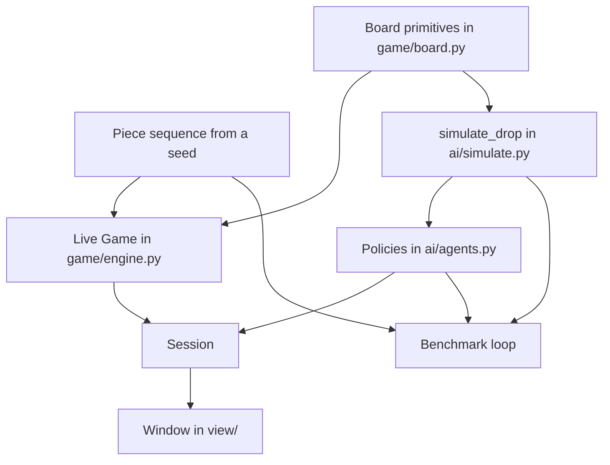

# Overview

A game is a sequence of pieces falling into a well. The rules live in `game/`. A policy, when one is playing, looks at the locked board and the current piece, then names one hard drop. Two callers use that same idea:

- The window, through `session.py`, for a person or for the heuristic.
- The benchmark, through `evaluation/benchmark.py`, for the heuristic and two baselines, with no window and no clock.

## The contract

The well is 10 columns by 20 rows. Row 0 is the top and row 19 is the floor. A cell is `0` when empty, or `1`–`7` for the tetromino that locked there: I, O, T, S, Z, J, L.

A move is a rotation plus the column of the piece's leftmost block. The piece then falls straight down from the top of that column. Rotations that overlap a block or leave the well are rejected. There are no wall kicks, no hold piece, and no next-piece preview.

The falling piece is not written onto the board. `Game.board` holds only locked cells. The current piece is a separate pose: piece id, rotation, row, and column. It joins the board in `Game._lock`, which also clears full rows and adds the score.

Simulation follows the same primitives and leaves the caller's board alone. `simulate_drop` copies the board, drops from row 0, locks, clears, and returns the copy plus the number of lines removed. The live game changes only when that move is actually played.

## Two scores

The number on the panel is the game score. One lock awards 100, 300, 500, or 800 points for one, two, three, or four lines. `line_score` in `game/constants.py` is that table.

The search uses a different number, `H`. A four-line clear is worth four lines to `H` and 800 points to the game. Four separate single-line clears are also four lines to `H`, and only 400 points on the panel. The two are never mixed.

## One ply

The heuristic sees the locked board and the piece that was just drawn. It does not see the piece after that. For the current piece it lists every legal hard drop, scores the board each drop would leave, and plays the best one. That is one ply of informed search: every successor is generated and ranked, and nothing is searched past the next lock.

Ties keep the earliest rotation, then the leftmost column, because comparison is strict `>` and drops are listed in that order.

An empty move list means the piece cannot be placed. For the heuristic, that ends the game. A human ends the game earlier, when the centered spawn pose itself overlaps the stack. Those are different tests. The center can be blocked while a column off to the side still fits, so the same board can kill a human and still be playable for the heuristic.

## Where a seed goes

`random.Random(seed)` draws pieces with `draw_piece`: `1 + rng.randrange(7)`. Each piece is independent and uniform. There is no 7-bag.

The window prints the seed it is using. `R` rebuilds the game from that seed, so the same sequence plays again. The benchmark uses seeds 0 through 19 and gives every policy the same sequence. `RandomAgent` has a second generator, used only to pick among legal drops, so its choices do not change which pieces appear.
